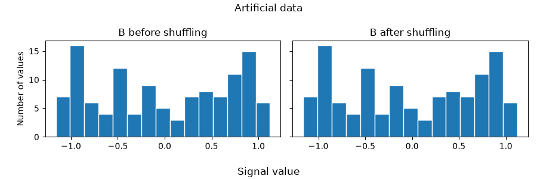

# Time series shuffle experiment

[Download Signal Shuffle for Windows](https://github.com/polarvapourer/Time-Series-Shuffle/releases/latest/download/SignalShuffle.exe)

I used Python to generate two artificial signals: a sine wave and a noisy
copy delayed by four time steps. I then shuffled the copy to see which
checks would detect the change.

## Result

Every bar in the histogram had the same height before and after shuffling.
When I accounted for the four-step delay, the correlation between the
signals fell from 0.99 to -0.13. The histogram alone missed the change
because it counts values without recording when they occurred.



## Run on Windows

```powershell
py -m pip install numpy matplotlib
py Signal_Shuffle.py
```

Close each plot window to see the next one. After the last plot, the
script prints the correlations.
